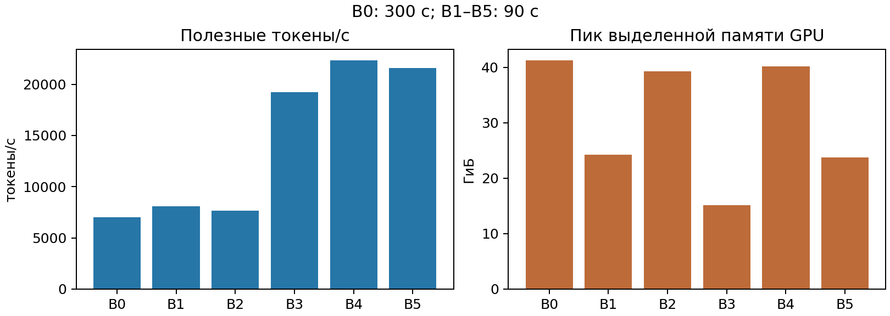
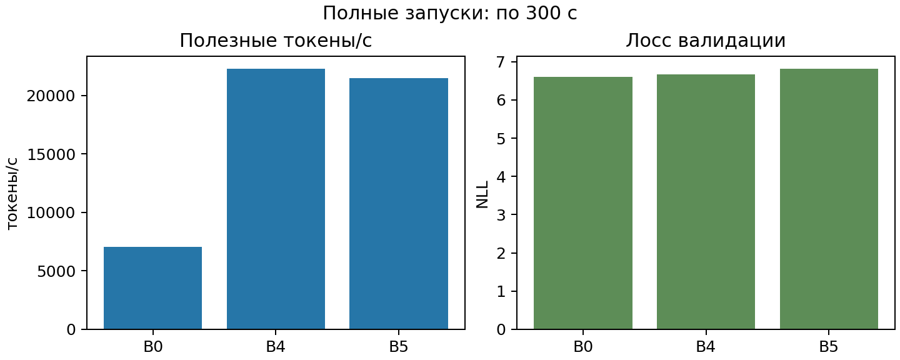

# ДЗ 2. Ускорение обучения Qwen3

## Сетап

Мы обучали модель из шаблона с нуля на одной A100 80 ГБ. Данные, токенизатор и разделение train/validation соответствовали шаблону. Длина последовательности равнялась 512. Мы сохранили BF16, AdamW fused, learning rate, scheduler и seed. Для каждого опыта мы создали новый каталог. Бейзлайн и два повторных запуска длились 300 секунд. Остальные опыты длились 90 секунд. `tokens_per_second` считает полезные токены после первых 10 шагов оптимизатора.

## Результаты

Перенесите числа из `results/<запуск>/summary.json`. Укажите фактический батч из `config.json`, если запускатор применил замену после CUDA OOM. Пик памяти равен `peak_allocated_gib`. BFD packing включает padding-free.

| Опыт | Отличие от B0 | Время, с | Токены/с | Пик памяти, ГиБ | Validation loss | Шаги |
| --- | --- | ---: | ---: | ---: | ---: | ---: |
| B0 | SDPA; 32 × 2 | … | … | … | … | … |
| B1 | Батч: … | … | … | … | … | … |
| B2 | FlashAttention 2 | … | … | … | … | … |
| B3 | B2 + padding-free | … | … | … | … | … |
| B4 | B3 + BFD packing | … | … | … | … | … |
| B5 | B4 + батч: … | … | … | … | … | … |
| Полный 1: … | Повторный запуск, 300 с | … | … | … | … | … |
| Полный 2: … | Повторный запуск, 300 с | … | … | … | … | … |

Итоговая конфигурация: **…**. Ускорение: **S = … / … = …**. Для S используйте только два 300-секундных запуска: итоговый и B0.

## Наблюдения

1. Сравните B1 с B0. Укажите изменение скорости и памяти. Объясните влияние микробатча и накопления градиента.
2. Сравните B2 с B0, затем B3 с B2. Укажите изменение скорости, памяти и числа полезных токенов.
3. Сравните B4 с B3 и B5 с B4. Объясните эффект packing и его сочетания с размером батча.

## Ограничения

Мы выполнили один запуск каждой конфигурации. Короткие и полные запуски обработали разное число токенов. Поэтому сравнивайте validation loss вместе с числом обработанных токенов. Отдельные результаты не оценивают разброс между запусками. Мы не проверяли `torch.compile`, Liger, activation checkpointing и offloading.

