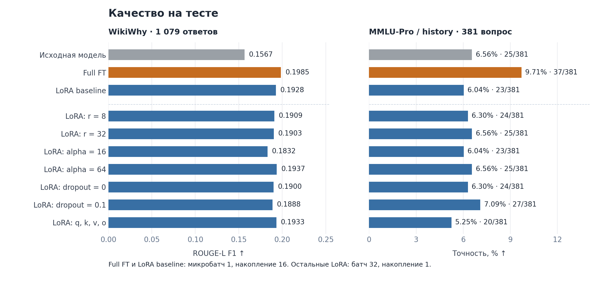
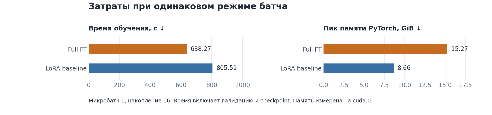

# HW4. Full FT и LoRA

Модель отвечает на вопросы WikiWhy и объясняет причины. Сравниваются качество, время обучения и память.

## Условия

Используется `Qwen/Qwen2.5-1.5B-Instruct`. В WikiWhy выделено 7 397 примеров для обучения, 924 для валидации и 1 079 для теста. Модель получает только вопрос. Loss учитывает только ответ.

Обучение длится одну эпоху. Общие настройки: learning rate `2e-5`, максимальная длина 1 024 токена, seed `42`, `bfloat16`, gradient checkpointing. Используется A100-SXM4-80GB.

LoRA baseline использует `r=16`, `alpha=32`, `dropout=0.05` и модули `q_proj/v_proj`. Full FT обновляет все веса. LoRA обновляет только адаптеры.

Full FT и LoRA baseline используют микробатч 1 на устройство и накопление градиента 16. Остальные варианты LoRA используют батч 32 на устройство без накопления. Поэтому их сравнение с baseline не выделяет чистый эффект параметра.

## Результаты

ROUGE-L измеряет совпадение ответа с эталоном. Точность по истории — число верных ответов, делённое на общее число вопросов.





## Выводы

- **Full FT предпочтительнее для этой задачи на доступном оборудовании.** Он даёт лучший ROUGE-L и обучается быстрее LoRA baseline.
- **LoRA подходит при ограничении памяти.** Baseline снижает её расход на 43%, но увеличивает время на 26%. Обучаемых параметров в 708 раз меньше.
- Среди LoRA лучший ROUGE-L даёт `alpha=64`. Увеличение ранга не улучшает результат.

Исторический prompt требует букву, но варианты не имеют буквенных меток. Ошибки формата снижают точность. Эта метрика не позволяет отдельно оценить исторические знания. Все выводы относятся к запускам с одним seed.

## Запуск

```bash
bash setup_env.sh
.venv/bin/python download_data.py
```

Выберите ядро `Python (hw4_lora)`. Выполняйте ноутбуки по порядку: [данные](01_data.ipynb), [обучение](02_training.ipynb), [оценка](03_evaluation_report.ipynb). Они содержат полные конфигурации, числа и примеры ответов.
