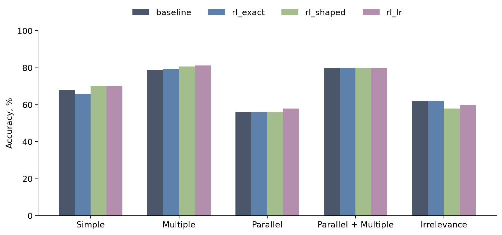
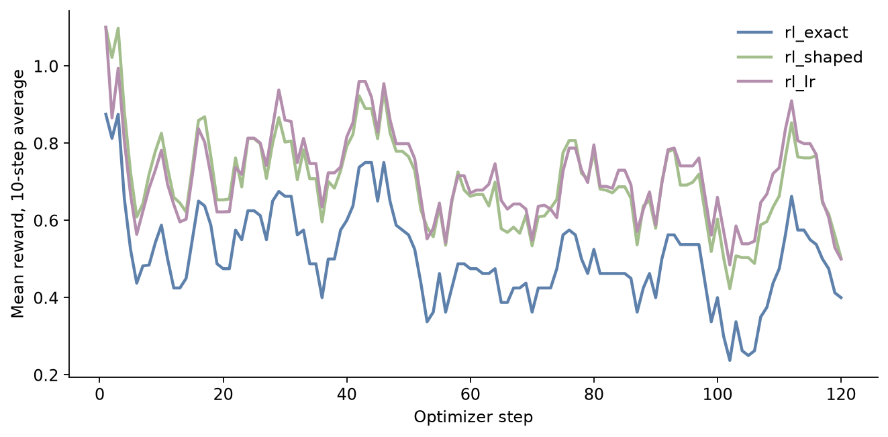
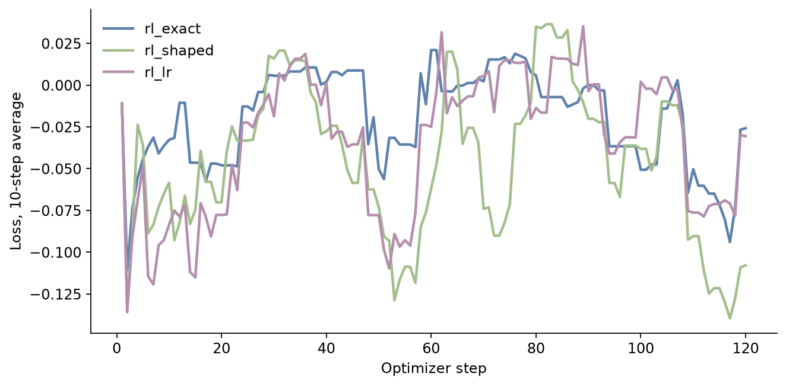

# HW5. RL для вызова инструментов

Модель — `Qwen/Qwen3.5-2B`, ревизия `15852e8c16360a2fea060d615a32b45270f8a8fc`.
Обучение идёт на ToolACE: 11 808 примеров, seed 42, одна A100 80 GB.
Оценка — исходный `evaluate.py` на 350 примерах `bfcl.jsonl`.
Лучший запуск — `rl_lr`. Его BFCL overall равен 69.87%. Overall baseline равен 68.93%.

Таблицу, графики и примеры ответов строит [results.ipynb](results.ipynb). Ноутбук читает `artifacts/` и `results/`. Ноутбук не загружает модель.

## Сравнение качества

Качество измеряют два числа на одном и том же срезе из 350 примеров.

- `overall` — среднее пяти групп BFCL.
- `accuracy` — число верных ответов, делённое на 350.

| Запуск | Overall | Accuracy | Верных ответов | Разница с baseline |
| --- | ---: | ---: | ---: | --- |
| `rl_lr` | 69.87% | 73.14% | 256 / 350 | +5 ответов, +0.94 п.п. overall |
| `rl_shaped` | 68.93% | 72.29% | 253 / 350 | +2 ответа, overall без изменения |
| Baseline | 68.93% | 71.71% | 251 / 350 | — |
| `rl_exact` | 68.67% | 71.71% | 251 / 350 | 0 ответов, −0.26 п.п. overall |

120 шагов равны 1.02% эпохи. Этого объёма мало, чтобы `rl_exact` отделился от baseline.
`rl_exact` и baseline дают одно и то же число верных ответов: 251 из 350.
Веса `rl_exact` при этом сдвинулись: L2-норма разницы равна 0.149. Качество BFCL не изменилось.
На 76 шагах из 120 все 8 ответов группы получили одну и ту же награду `exact`. Advantage этих шагов равен 0.
Те же 120 шагов с наградой `shaped` уже двигают качество: `rl_shaped` даёт +2 ответа, `rl_lr` даёт +5.
`rl_lr` лучше baseline по обоим числам. `rl_shaped` не поднимает overall: Irrelevance падает с 62% до 58%.
`rl_exact` чуть снижает overall, потому что Simple падает с 68% до 66%.

## Условия

Три запуска стартуют с одних и тех же весов. Каждый запуск делает 120 шагов optimizer.
120 шагов равны 1.02% эпохи. Trainer останавливается на лимите шагов.
Один шаг берёт 8 промптов. На каждый промпт модель пишет 8 ответов.
LoRA обновляет `q_proj` и `v_proj`. Rank равен 8. Alpha равен 16. Обучаемых параметров 417 792.
Learning rate постоянный. У `rl_exact` и `rl_shaped` он равен `2e-5`. У `rl_lr` он равен `1e-5`.
Температура при обучении равна 1.0. BFCL использует температуру 0.

Награда `exact` равна 1 при полном совпадении вызовов. Иначе награда равна 0.
Награда `shaped` равна `exact + 0.2 × F1(имена функций) + 0.05 × format`. Верхняя граница равна 1.25.
`rl_exact` получает награду `exact`. `rl_shaped` и `rl_lr` получают награду `shaped`.
`rl_lr` отличается от `rl_shaped` только learning rate.

BFCL overall — среднее пяти групп. Overall не равен доле верных ответов среди 350 примеров.
Группа Multiple объединяет обычные и live-примеры. Группа Irrelevance делает то же самое.

## BFCL

| Запуск | Overall | Δ, п.п. | Simple | Multiple | Parallel | Parallel + Multiple | Irrelevance |
| --- | ---: | ---: | ---: | ---: | ---: | ---: | ---: |
| Baseline | 68.93% | 0.00 | 68.00% | 78.67% | 56.00% | 80.00% | 62.00% |
| `rl_exact` | 68.67% | −0.26 | 66.00% | 79.33% | 56.00% | 80.00% | 62.00% |
| `rl_shaped` | 68.93% | 0.00 | 70.00% | 80.67% | 56.00% | 80.00% | 58.00% |
| `rl_lr` | **69.87%** | **+0.94** | **70.00%** | **81.33%** | **58.00%** | 80.00% | 60.00% |

Parallel + Multiple равен 80% у всех четырёх моделей.
`rl_lr` поднимает Simple, Multiple и Parallel. Irrelevance у `rl_lr` ниже baseline: 60% против 62%.

## Обучение

Линия на графике — среднее за 10 шагов. Награды `exact` и `shaped` имеют разный масштаб.

| Запуск | Награда | Learning rate | Награда, шаги 1–20 | Награда, шаги 101–120 | Шаги с нулевым advantage | Время, с |
| --- | --- | ---: | ---: | ---: | ---: | ---: |
| `rl_exact` | exact | 2e-5 | 0.531 | 0.438 | 76 / 120 | 1822 |
| `rl_shaped` | shaped | 2e-5 | 0.739 | 0.583 | 54 / 120 | 335 |
| `rl_lr` | shaped | 1e-5 | 0.702 | 0.618 | 53 / 120 | 1645 |

Время `rl_exact` — сумма времени шагов. Trainer не записал итоговый runtime для этого запуска.
Время `rl_shaped` и `rl_lr` взято из итогового runtime.

## Ответы

1. **Почему такая награда?** BFCL проверяет имя функции и аргументы. Награда `exact` повторяет эту проверку. Награда `shaped` даёт частичный сигнал, когда имя верное, а аргументы ещё нет.
2. **Что сдвинуло BFCL сильнее?** Замена learning rate `2e-5` на `1e-5` при той же награде `shaped` даёт +0.94 п.п. overall. Замена награды `exact` на `shaped` при learning rate `2e-5` даёт +0.26 п.п. Оба сдвига малы. Вывод относится к одному seed и к 120 шагам.
3. **Совпадает ли рост награды с ростом BFCL?** Средняя награда падает во всех трёх запусках. BFCL при этом равен baseline у `rl_shaped` и выше baseline у `rl_lr`. Награда на ToolACE и проверка BFCL измеряют разные вещи.
4. **Что при одинаковых наградах в группе?** Advantage этой группы равен 0. Так происходит на 76 шагах из 120 у `rl_exact`, на 54 шагах у `rl_shaped` и на 53 шагах у `rl_lr`.
5. **Какие ошибки остались у `rl_lr`?** Запуск исправил 7 ответов baseline и испортил 2.

| BFCL id | Результат `rl_lr` | Факт |
| --- | --- | --- |
| `simple_24` | Исправлен | Baseline не вызвал инструмент. `rl_lr` вызвал `math.gcd(12, 18)`. |
| `simple_241` | Ошибка осталась | Модель ответила текстом про Lincoln. Эталон требует вызов инструмента. |
| `simple_150` | Ошибка осталась | Модель передала ставку `3`. Эталон требует `0.03`. |
| `live_multiple_793-174-7` | Ответ испорчен | Модель поставила дату `2024-03-14`. Эталон и baseline используют `2023-03-14`. |
| `live_irrelevance_142-13-8` | Ответ испорчен | Модель вызвала `ControlAppliance`. Эталон и baseline не требуют вызова. |

## Повтор

Откройте [results.ipynb](results.ipynb) и выполните ячейки сверху вниз.
Ноутбук сохраняет `artifacts/comparison.csv`, `artifacts/training.csv` и файлы в `plots/`.
