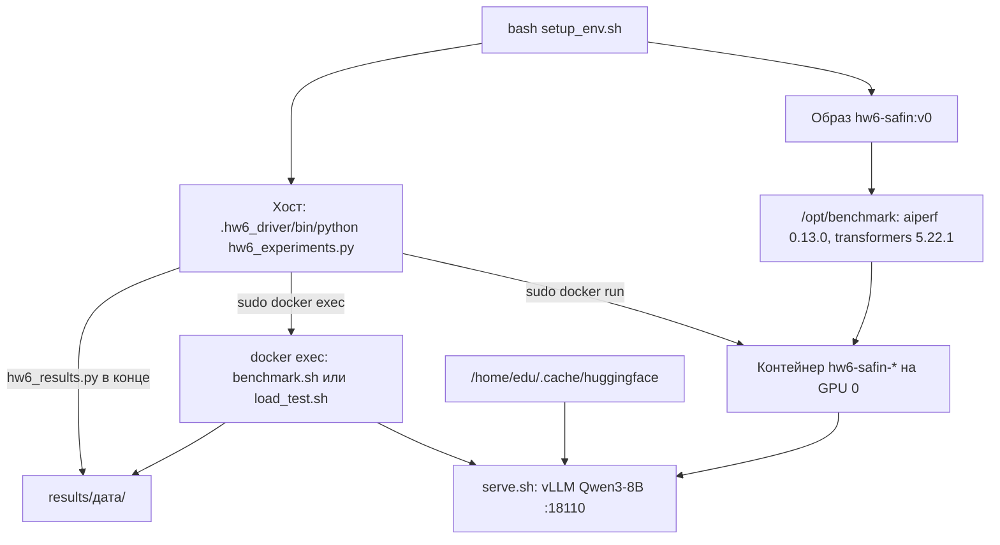
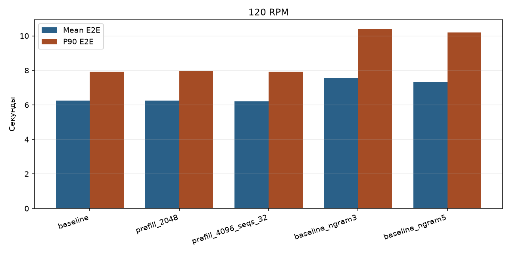
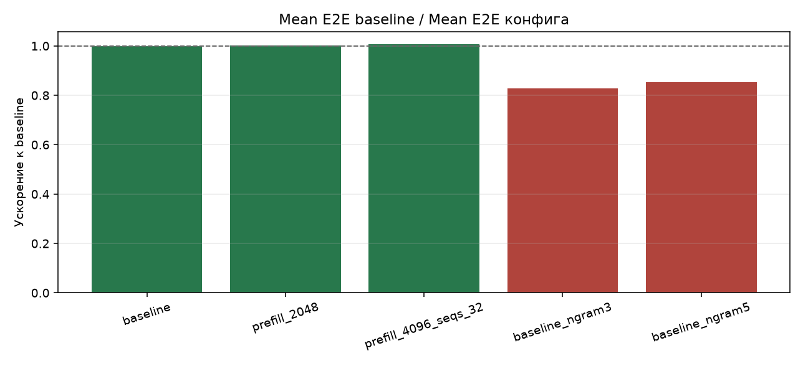
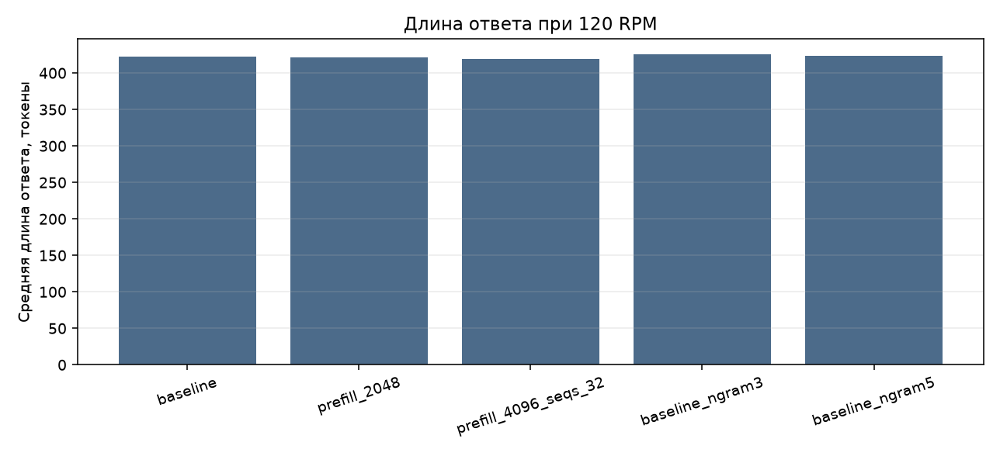
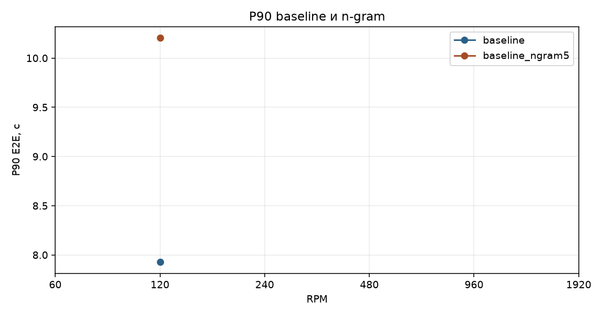

# HW6. Оптимизация инференса Qwen3-8B

## Запуск

Нужны Linux, NVIDIA GPU 0 и `sudo docker`. Занимать можно только GPU 0. Порт сервера — `127.0.0.1:18110` (`8000` на этой машине уже занят).

Из каталога `LLM/hw6`:

```bash
bash setup_env.sh
# полный прогон, несколько часов: все конфиги, 640 запросов, кривая RPM и SLA
.hw6_driver/bin/python -u hw6_experiments.py
# уложиться в ~20 минут: 3 конфига, 120 запросов, прогрев 8, без кривой RPM и SLA
HW6_SHORT=1 .hw6_driver/bin/python -u hw6_experiments.py
```

`setup_env.sh` собирает образ `hw6-safin:v0` и маленький `.hw6_driver` с `matplotlib` и `nbformat`. Сам прогон делает вторая команда. [run_hw6.ipynb](run_hw6.ipynb) повторяет полный сценарий и вместе со скриптом его не запускают.

Короткий режим берёт `baseline`, `prefill_4096_seqs_32` и `baseline_ngram3`. После них в ту же папку дописываются `prefill_2048` и `baseline_ngram5` (`HW6_RESUME=results/<запуск>`). На каждый конфиг сервер стартует заново: флаги vLLM читаются только при запуске. Один такой кусок — старт (обычно 2–4 минуты) плюс бенчмарк около 2–3 минут.

## Как устроено

Оркестратор живёт на хосте. vLLM и AIPerf живут в одном контейнере на GPU 0. Хостового окружения с AIPerf нет.



Что куда монтируется при `docker run`:

| Что | Куда в контейнере | Зачем |
| --- | --- | --- |
| Каталог `hw6` | тот же абсолютный путь | `benchmark.sh`, `load_test.sh`, `serve.sh` и папка `results/` |
| `/home/edu/.cache/huggingface` | `/root/.cache/huggingface` | веса `Qwen/Qwen3-8B`, уже скачаны |
| GPU 0 по UUID | единственная карта контейнера | `--gpus device=<uuid GPU 0>` |

Контейнер в сети хоста, слушает только `127.0.0.1:18110`. AIPerf бьёт в этот адрес из того же контейнера, поэтому клиенту не нужен проброс порта. Перед каждой точкой `benchmark.sh` / `load_test.sh` сбрасывают prefix cache. Пока конфиг не сменился, vLLM не перезапускается.

Скрипт сам проходит три этапа и в `finally` вызывает `hw6_results.write_results`. Отчётный ноутбук появляется в папке прогона даже если поздний этап упал, но уже были записанные точки.

| Этап | Где в коде | Что запускается внутри контейнера |
| --- | --- | --- |
| 120 RPM, подбор конфига | `run_fixed` | `benchmark.sh`, все 640 запросов |
| n-gram по нагрузкам 60…1920 RPM | `run_spec` | `benchmark.sh` |
| Поиск SLA, 300 с на точку | `run_capacity` | `load_test.sh` |

Файлы одной точки: `results/<запуск>/<этап>/<конфиг>/<rpm>rpm/profile/` и лог `results/<запуск>/logs/`. Сводка после каждой точки — `results.csv` и `results.json`.

## Методика

Во всех прогонах `Qwen/Qwen3-8B` получает только исходные запросы `data/requests.jsonl` через AIPerf в режиме raw payload. В запросах уже заданы `enable_thinking=false`, `temperature=0`, `seed=42` и `max_tokens=512`. Нагрузка подаётся с постоянным интервалом. Перед каждым прогоном сбрасываем prefix cache, затем выполняем одинаковый прогрев на 40 запросах. Статистику прогрева не включаем. Латентность берём из `request_latency` AIPerf и переводим миллисекунды в секунды.

1. **120 RPM.** На всех 640 запросах измеряем дефолтный vLLM, бюджет батча в 2048 токенов, бюджет 4096 с лимитом в 32 последовательности и n-gram с 3 или 5 спекулятивными токенами. Если лучшая конфигурация без n-gram отличается от дефолтной, проверяем её сочетание с лучшим n-gram. Выбираем минимальную среднюю E2E latency, при равенстве смотрим P90. Ускорение равно отношению средней латентности бейзлайна к средней латентности кандидата.
2. **Спекулятивное декодирование.** Для каждого RPM используем те же 640 запросов. Сравниваем дефолтный vLLM и его вариант с лучшим n-gram при 120 RPM. На графике отмечаем первый измеренный RPM, где P90 n-gram выше P90 бейзлайна. Для 120 RPM переиспользуем замеры первого этапа. Невалидные точки оставляют пропуск на графике.
3. **SLA.** Победитель первого этапа получает нагрузку через `load_test.sh` по 300 секунд на точку. Когда 640 исходных запросов заканчиваются, AIPerf продолжает с начала файла. Проверяем, что клиент фактически подал заданную нагрузку. Для прохождения SLA все запросы должны завершиться без ошибок, а P90 E2E должен быть строго меньше 15 секунд. Поиск начинает со 120 RPM, удваивает нагрузку до провала или до лимита и уточняет границу на сетке 15 RPM. Если первая точка провалилась, поиск проверяет меньшие нагрузки. Алгоритм предполагает, что с ростом RPM вероятность нарушения SLA растёт. Итог содержит наибольшую проверенную успешную нагрузку и ближайший измеренный провал выше неё, если такой провал есть.

## Результаты прогона

В папке `results/<запуск>/` сохраняются следующие файлы.

- `results.csv` и `results.json` со всеми замерами и статусами, записываются после каждой точки.
- `summary.json` с победителем, сравнением P90 и измеренной границей SLA.
- `results_notebook.ipynb` с таблицами и встроенными графиками. Его можно открыть без повторных замеров. Отдельные PNG сохраняются как `spec_p90.png` и `capacity_p90.png`.
- `environment.json` с параметрами стенда и хешем данных. В подпапках этапов лежат выгрузки AIPerf, в `logs/` — вывод AIPerf и vLLM.

Для отчёта сохраните всю папку прогона. Она содержит статистику и журналы для разбора отклонений.

## Отчёт

Прогон лежит в `results/20261119-232509-302829`.
Профиль прогона — `short+2`.
Модель — `Qwen/Qwen3-8B`.
Сервер — vLLM 0.22.0.
Клиент — AIPerf 0.13.0.
GPU — NVIDIA A100-SXM4-80GB.

Каждый замер берёт 120 запросов из 640.
Нагрузка равна 120 RPM.
Прогрев равен 8 запросам.
Замер содержит только фазу profiling.
Число ошибок равно 0.
Отклонение фактической подачи от 120 RPM меньше 2 %.

Ускорение S равно Mean E2E baseline / Mean E2E конфигурации.
Значение S больше 1 означает меньшую среднюю задержку E2E.

### Какие эксперименты сделаны

1. Сравнение пяти конфигураций при 120 RPM.
2. Сравнение P90 baseline и лучшего n-gram. Скрипт измерил только 120 RPM.
3. Поиск SLA. Число точек по 300 с равно 0.

Сначала скрипт записал `baseline`, `prefill_4096_seqs_32` и `baseline_ngram3`.
Затем скрипт дописал в ту же папку `prefill_2048` и `baseline_ngram5`.

| Конфигурация | Аргументы vLLM |
| --- | --- |
| `baseline` | аргументы vLLM по умолчанию |
| `prefill_2048` | `--max-num-batched-tokens 2048` |
| `prefill_4096_seqs_32` | `--max-num-batched-tokens 4096`, `--max-num-seqs 32` |
| `baseline_ngram3` | n-gram, 3 спекулятивных токена, prompt lookup от 2 до 5 |
| `baseline_ngram5` | n-gram, 5 спекулятивных токенов, prompt lookup от 2 до 5 |

### Результат при 120 RPM

| Конфигурация | Mean E2E, с | P90 E2E, с | S | Средняя длина ответа, токены | Ошибки |
| --- | --- | --- | --- | --- | --- |
| `baseline` | 6,254 | 7,927 | 1,000 | 422,1 | 0 |
| `prefill_2048` | 6,245 | 7,937 | 1,001 | 421,2 | 0 |
| `prefill_4096_seqs_32` | 6,207 | 7,914 | 1,007 | 418,9 | 0 |
| `baseline_ngram3` | 7,556 | 10,401 | 0,828 | 425,2 | 0 |
| `baseline_ngram5` | 7,333 | 10,205 | 0,853 | 423,1 | 0 |

Наименьшую Mean E2E даёт `prefill_4096_seqs_32`.
P90 E2E у `prefill_4096_seqs_32` тоже наименьший.

Mean E2E и P90 E2E при 120 RPM:



Три конфигурации без n-gram дают почти одну задержку E2E.
Две конфигурации n-gram дают большую задержку E2E.

Ускорение к baseline. Горизонтальная линия показывает S = 1.



Зелёный столбец показывает S ≥ 1.
Красный столбец показывает S < 1.

Средняя длина ответа при 120 RPM:



Средняя длина ответа лежит в диапазоне 418,9–425,2 токена.
Разброс равен 6,3 токена. Это около 1,5 % от длины baseline.

### P90 и спекулятивное декодирование

Лучший n-gram по Mean E2E — `baseline_ngram5`.
Скрипт измерил пару baseline и `baseline_ngram5` только при 120 RPM.
Нагрузки 60, 240, 480, 960 и 1920 RPM скрипт в этом прогоне не измерял.

| RPM | P90 baseline, с | P90 `baseline_ngram5`, с | Разница, с |
| --- | --- | --- | --- |
| 120 | 7,927 | 10,205 | +2,278 |

P90 baseline и n-gram. Пустая точка на оси означает пропуск замера.



При 120 RPM P90 n-gram выше P90 baseline на 2,278 с.
Эта точка — единственный измеренный RPM, где n-gram медленнее baseline по P90 E2E.

Пропускная способность выходных токенов при 120 RPM:

| Конфигурация | Выходные токены, токен/с | Завершённые запросы, запрос/с |
| --- | --- | --- |
| `baseline` | 764,5 | 1,811 |
| `prefill_2048` | 762,8 | 1,811 |
| `prefill_4096_seqs_32` | 758,6 | 1,811 |
| `baseline_ngram3` | 762,0 | 1,792 |
| `baseline_ngram5` | 756,7 | 1,789 |

Подача равна 2 запроса/с.
Сервер завершает около 1,81 запроса/с.
Число завершённых запросов меньше числа поданных запросов.
Очередь есть на baseline.
Пропускная способность выходных токенов у n-gram остаётся около 757–762 токен/с.

### SLA

Статус этапа SLA — `not_started`.
Число точек по 300 с равно 0.
Наибольшая нагрузка с P90 E2E < 15 с неизвестна.
Папка прогона содержит четыре графика сравнения. Графика SLA в папке нет.

### Выводы

1. Победитель по правилу отбора — `prefill_4096_seqs_32`. Mean E2E равен 6,207 с. P90 E2E равен 7,914 с. S равен 1,007.
2. Выигрыш `prefill_4096_seqs_32` к baseline равен 0,046 с. Это 0,7 %. На 120 запросах разница мала.
3. `prefill_2048` почти равен baseline. S равен 1,001. P90 E2E равен 7,937 с. Это на 0,010 с выше P90 baseline.
4. Оба n-gram увеличивают задержку E2E. `baseline_ngram3` даёт S = 0,828. `baseline_ngram5` даёт S = 0,853.
5. Пять спекулятивных токенов быстрее трёх. Mean E2E и P90 E2E у обоих n-gram выше, чем у baseline.
6. Длина ответа у пяти конфигураций почти одна. Разницу задержки E2E даёт конфигурация vLLM.
7. При 120 RPM n-gram на этом датасете увеличивает задержку E2E. Пропускная способность выходных токенов остаётся около 757–764 токен/с.
8. Кривая P90 по нагрузкам 60…1920 RPM в прогоне отсутствует. Граница SLA в прогоне отсутствует. Полный запуск без `HW6_SHORT` выполняет эти два этапа.
